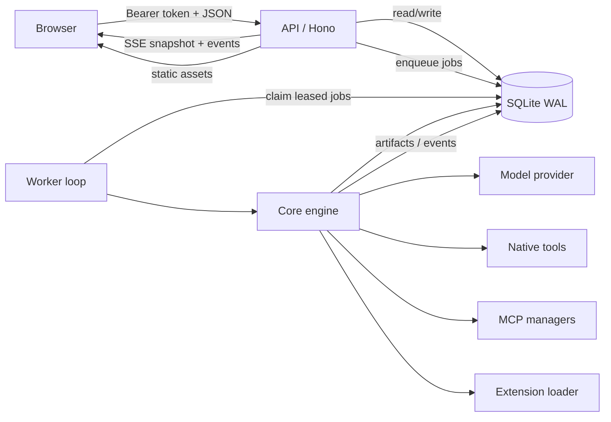

# SWARM — Architecture

**Version:** 0.1  
**Last updated:** 2026-10-31  
**Related:** [PRD](PRD.md), [Data Model](DATA_MODEL.md), [Tool Runtime](TOOL_RUNTIME.md), [Security](SECURITY_AND_PERMISSIONS.md)

---

## 1. Overview

SWARM is a web-first TypeScript system with four deployable units:

- **Web** — React command center.
- **API** — Hono HTTP server, REST endpoints, SSE, static web hosting.
- **Worker** — durable job processor. It runs inline in the API by default, or as a separate process.
- **Core** — shared domain, persistence, orchestration, provider, tool, MCP, extension, and security logic.

The system is local-first. A single SQLite database holds all state, including the job queue and append-only run events. No Docker, Postgres, Redis, or cloud queue is required.



The API is a control plane. It does not execute model turns or tool calls itself. It validates requests, persists intent (for example, create run → enqueue `interpret_goal`), and projects state to clients. The worker loop claims jobs and runs the orchestration engine. This split is what makes the standalone worker meaningful: the web/API process can be restarted independently of job execution.

## 2. Workspace layout

```text
swarm/
  apps/
    api/        Hono server, REST/SSE, static serving, inline worker
    web/        React 19 + Vite command center
    worker/     standalone polling worker
  packages/
    core/       all shared runtime logic + tests
  scripts/
    smoke.mjs   mock-model end-to-end API smoke
  docs/
```

`packages/core` is not a thin library. It owns the product's actual execution semantics:

| Area | Main files |
| --- | --- |
| Configuration | `src/config.ts`, `src/utils/env.ts` |
| Runtime factory | `src/bootstrap.ts` |
| Contracts | `src/contracts/common.ts` |
| Domain packs | `src/domain/*.ts` |
| Persistence | `src/db/database.ts`, `src/db/repository.ts` |
| Provider adapters | `src/providers/*.ts` |
| Workforce planning | `src/workforce/*.ts` |
| Agent loop | `src/runtime/agent-loop.ts`, `accounting.ts`, `prompts.ts` |
| Orchestration | `src/orchestrator/engine.ts` |
| Native tools | `src/tools/*.ts` |
| MCP | `src/mcp/client.ts`, `manager.ts` |
| Extensions | `src/extensions/loader.ts` |
| Security | `src/security/*.ts` |

## 3. Request and execution lifecycle

### 3.1 Create run

1. `POST /api/workspaces/:workspaceId/runs` validates the goal.
2. `SwarmEngine.createRun()` requires a configured model provider. This prevents creating runs that can never execute.
3. A `runs` row is created with status `interpreting`.
4. A `run_created` event and activity are appended.
5. An `interpret_goal` job is enqueued with idempotency key `interpret:<runId>`.

### 3.2 Interpret and plan

`interpret_goal` is handled by `handleInterpret()`:

- If the run already has a valid persisted interpretation/plan (for example after a retry), it reuses it.
- Otherwise it calls the goal interpreter through `AccountedProvider`, so the call counts against the run's budgets.
- Interpretation is validated with Zod. Invalid output falls back to a deterministic interpretation derived from the goal and domain keywords.
- Planning uses the domain-pack catalogue, hard limits, and workspace policy note.
- A model plan is validated. Invalid plans get one corrective retry. Repeated failure produces a deterministic domain-template plan and visible warnings.
- Agents are materialized once; tasks are inserted with dependencies.
- Run status becomes `executing`; ready tasks are enqueued.

### 3.3 Execute tasks

The worker claims one queued job at a time under a 10-minute lease. For `execute_task`:

1. Skip if the run/task is terminal, dependencies are incomplete, or the task is awaiting approval.
2. Increment attempts; fail the run if the task exceeds `maxAttempts`.
3. Mark task `running`, agent `working`, run `executing`.
4. Build task context: run, task, agent definition, interpretation, workspace memories, dependency outputs, allowed tools.
5. Run `AgentRunner.start()`.

The agent loop is persisted after every turn. It:

- checks cancellation and budgets before every model call;
- sends system + user prompts and available tool schemas to the provider;
- appends assistant messages and tool calls to runtime state;
- resolves tool policy in the backend;
- either executes a tool, denies it, or suspends for approval;
- retries invalid deliverable JSON twice with a correction prompt;
- writes the final deliverable as an artifact and updates task output.

### 3.4 Approval suspension and resume

When policy returns `approval`:

- a `tool_executions` row is created with status `awaiting_approval`;
- an `approvals` row is created with kind `tool` or `purchase`, a 24-hour expiry, and a redacted payload;
- task, run, and agent move to `awaiting_approval`;
- the remaining tool calls and current runtime state are persisted;
- the engine returns without completing the task.

A decision:

- updates the approval and tool execution;
- moves the task back to `running`;
- enqueues `resume_task` with a key derived from the approval;
- on approval, executes the same pending call once and continues;
- on denial/expiry, injects a tool error message and lets the agent adapt;
- records an activity and run event.

If approvals expire, the worker sweep resumes tasks with a timeout/denial rather than leaving the run suspended forever.

### 3.5 Review and finalize

When all tasks are completed or skipped:

- run status becomes `reviewing`;
- `review_run` calls a reviewer prompt with all completed outputs, tool statuses, and approvals;
- the review is stored as a markdown artifact and a `review_completed` event;
- `finalize_run` asks the lead synthesizer for the final deliverable;
- the final artifact is stored, the run becomes `completed`, agents become `done`.

Both review and finalization have explicit fallbacks. They never silently claim that a failed model call succeeded.

### 3.6 Cancellation

`POST /api/runs/:runId/cancel`:

- sets `cancel_requested=1` and status `cancelled`;
- cancels pending approvals;
- cancels pending/ready/running/blocked tasks;
- marks non-done agents failed;
- records an event.

The model caller and agent loop also check `cancel_requested`, so a run cannot keep consuming budget after cancellation. Queued jobs are drained and ignored.

## 4. Job model

| Job | Purpose | Idempotency key |
| --- | --- | --- |
| `interpret_goal` | Interpret and plan a new run. | `interpret:<runId>` |
| `execute_task` | Run one ready task. | `execute:<taskId>:<attempt>` |
| `resume_task` | Continue after an approval decision/expiry. | `resume:<taskId>:<approvalId>:<decision>` |
| `review_run` | Independent quality review. | `review:<runId>` |
| `finalize_run` | Final synthesis artifact. | `finalize:<runId>` |

Jobs are SQLite rows with status `queued | leased | done | failed`. Claiming is a transaction: select the oldest available queued job, set `leased`, increment attempts, set `lease_until`. Retryable failures return the job to `queued` with exponential backoff capped at 30 seconds. Expired leases are reclaimed at worker startup. A unique `idempotency_key` prevents duplicate scheduling.

This is an at-least-once queue with idempotent scheduling. Tool executions additionally carry a content hash idempotency key for write-like calls, so a replay can return the prior success instead of repeating an external action.

## 5. Data and transaction boundaries

SQLite runs in WAL mode with foreign keys on, a 5-second busy timeout, and `synchronous=NORMAL`. Each database method is synchronous. Multi-step mutations use `BEGIN IMMEDIATE` transactions where needed.

Key relationships:

```text
workspace 1─* run 1─* agent
                 1─* task 1─1 task_runtime
                 1─* approval
                 1─* artifact
                 1─* activity
                 1─* run_event
                 1─* job
                 1─* tool_execution
                 1─* model_call
workspace 1─* secret
workspace 1─* integration
workspace 1─* mcp_server 1─* mcp_tool
workspace 1─* memory
```

Artifact content is stored in the database. This keeps backup/restore atomic for the MVP but will need object storage at scale. See [DATA_MODEL](DATA_MODEL.md).

## 6. Provider layer

`LlmProvider` has one job: accept a normalized request and return content, tool calls, usage, provider name, and model.

Supported:

- OpenAI (`/chat/completions`, JSON mode)
- OpenRouter (OpenAI-compatible with attribution headers)
- Anthropic (`/v1/messages`, native content blocks and tool_use)
- Any OpenAI-compatible local/remote endpoint

The adapter layer handles retries (HTTP 429/5xx, bounded attempts) and timeouts. `AccountedProvider` wraps the provider for interpretation/planning/review/finalization, while `ModelCaller` wraps specialist agent calls. Both write `model_calls` and increment run usage. Pricing is estimated from a local model pricing table; unknown models get `null` cost rather than a fabricated number.

No provider key is ever serialized into a run, artifact, log, or API response.

## 7. Tool architecture

A `SwarmTool` declares:

- name/description/JSON input schema;
- risk (`read`, `internal_write`, `external`, `purchase`, `destructive`);
- declared approval requirement;
- source (`native`, `mcp`, `extension`);
- read-only/write hints;
- an execute function with a tool context.

The engine builds a registry per task:

1. native tools;
2. enabled extension tools;
3. persisted MCP tools for the workspace.

Agent allowlists filter native tools. Non-native tools are added to every agent so MCP/extension capabilities are available, but policy always treats them as external and approval-gated by default.

Tool policy is covered in [TOOL_RUNTIME](TOOL_RUNTIME.md) and [SECURITY](SECURITY_AND_PERMISSIONS.md). Two invariants matter architecturally:

- The model cannot change its own permissions. It can only propose a tool call.
- Approval and denial are persisted states, not transient prompt instructions.

## 8. MCP

`McpClient` implements JSON-RPC 2.0 over:

- **HTTP** — streamable HTTP POST, `mcp-session-id` propagation, JSON or SSE responses, 30s request timeout.
- **stdio** — child process, newline-delimited JSON, stderr tail, 30s request timeout, explicit close.

`McpManager` caches clients, discovers tools (`tools/list` up to 10 pages), persists descriptors, updates connection status, closes idle clients, and drops failed clients. Headers/environment secrets are decrypted only in the server process.

MCP tools are namespaced as `mcp_<server>_<tool>` (max 64 chars) and executed through `tools/call`. Discovery sets `requiresApproval` unless the server's `readOnlyHint` is true. `destructiveHint` is captured in the client descriptor but not currently persisted separately.

## 9. Extensions

Extensions are JSON files in `SWARM_EXTENSION_DIR`:

- base URL + tool path/method/input schema/timeout;
- no JavaScript or other executable code;
- loaded only when `SWARM_ENABLE_EXTERNAL_EXTENSIONS=true`;
- HTTPS only, SSRF-checked, redirects disallowed;
- every call requires approval.

This is intentionally narrower than Axle's JS extension engine. See [EXTENSION_PLATFORM](EXTENSION_PLATFORM.md).

## 10. API surface

All `/api/*` routes except `/api/health` require `Authorization: Bearer <SWARM_API_TOKEN>` when a token is configured. Health is public so process supervisors and the smoke test can probe readiness.

| Group | Methods |
| --- | --- |
| Health/settings | `GET /api/health`, `GET /api/settings`, `GET /api/domain-packs` |
| Bootstrap/workspaces | `GET /api/bootstrap`, `GET/POST /api/workspaces`, workspace detail/settings |
| Runs | list/create, detail, cancel, `GET /api/runs/:id/events`, `GET /api/runs/:id/events/poll` |
| Approvals | list by workspace, decide |
| Artifacts | list, detail/content, download |
| Activity/workforce/tasks/tools | workspace-scoped read endpoints |
| Memories | list/create |
| Integrations | list/create/delete |
| MCP | list/create/connect/delete |

The run detail response includes run, workspace, agents, tasks, approvals, artifacts, activities, tool executions, model calls, jobs, and usage. Sensitive fields are redacted before serialization.

SSE sends:

- one event per persisted run event (`event: <type>`);
- a `snapshot` whenever the projected run state changes;
- `stream_end` on terminal state.

Polling uses `after` sequence numbers and returns the same snapshot shape. The UI's live hook attempts an authenticated `fetch` stream and falls back to polling on failure or unsupported environments. SSE is not a source of truth; the database is.

## 11. Web application

- React 19 with a custom hash router (`#/command`, `#/runs/:id`, etc.).
- No external UI framework. Hand-written CSS defines the dark visual system.
- `WorkspaceProvider` loads `/api/bootstrap`, workspace data, and provides refresh.
- Pages: Command, Run (overview/workforce/tasks/approvals/artifacts/activity/trace), Workforce, Tasks, Approvals, Artifacts, Activity, Integrations, Settings.
- Auth token is entered at boot when needed and stored in `localStorage`.
- Markdown is rendered by a small custom React renderer. It emits React nodes and never injects raw HTML.
- Artifact viewer handles text/markdown/JSON/CSV/HTML. HTML is shown as escaped source in a `<pre>` block and is never executed or rendered in an iframe.

The API serves the built web app; Vite proxies `/api` during development.

## 12. Deployment topologies

### Local default

```text
pnpm start
  API + inline worker + static web
  SQLite file in ./data
```

Best for a single user on one machine.

### Split API/worker

```text
SWARM_INLINE_WORKER=false pnpm start
pnpm worker
```

Both share the same `SWARM_DATA_DIR`. SQLite WAL permits readers and a writer, but only one worker loop is recommended. Start the worker against the same absolute path and encryption key.

### Future hosted topology

- API replicas behind a load balancer.
- Postgres for state, with a queue (BullMQ/Redis or managed queue) for jobs.
- Object storage for artifacts.
- KMS/secret manager for encryption keys.
- Per-tenant row-level isolation and RBAC.
- Network egress proxy with explicit allowlists.

This is not implemented. The repository layer is deliberately centralized so it can be replaced behind `Store`; see [DATA_MODEL](DATA_MODEL.md#11-postgres-migration-path).

## 13. Failure behavior

| Failure | Behavior |
| --- | --- |
| No model configured | Startup warns; UI shows setup; run creation returns 409 before inserting work. |
| Model timeout/error | Adapter retries retryable errors; failed call recorded; task/job retry or run failure. |
| Invalid JSON | Correction prompt, up to 2 attempts; then task failure with a clear error. |
| Invalid plan | One retry; deterministic fallback plan. |
| Reviewer failure | Labelled fallback review artifact. |
| Synthesis failure | Labelled concatenated final artifact. |
| Tool error/timeout | Tool execution marked failed/timeout; error returned to the model; agent must adapt. |
| Approval expiry | Tool marked timeout; task resumes with a denial message. |
| Process crash | Leased job is reclaimed after lease expiry; task runtime state remains in SQLite. |
| Run cancellation | Jobs stop, approvals cancel, pending work cancels. |
| Worker loop error | Logged, 1.5s backoff, loop continues. |

## 14. Architectural decisions and tradeoffs

| Decision | Why | Cost |
| --- | --- | --- |
| New TypeScript core instead of reusing Axle's Rust runtime | Axle is desktop/coding-bound and its protocol assumes local process/file orchestration. SWARM needs web-first, domain-neutral state. | Reimplementation effort; no direct access to Axle's provider/tool maturity. |
| SQLite instead of Postgres | Zero-dependency local-first startup is a product requirement. | Single-writer throughput ceiling; no multi-region hosting. |
| Persisted agent loop | Approval and restart require deterministic resume. | More state and serialization surface. |
| Domain packs + model planner | Universal coverage without hard-coding every possible team. | Model may choose poorly; deterministic fallback is less bespoke. |
| Declarative extensions only | Prevents arbitrary code execution in a multi-tenant future. | Less powerful than Axle's JS extensions. |
| SSE + polling | Live UI without a WebSocket dependency, with a simple fallback. | No bidirectional channel; approvals use REST. |
| Inline worker default | One-command dev and deployment. | API restarts also pause job processing. |
| Content in SQLite | Atomic backup/restore for MVP. | Database growth and memory pressure for large artifacts. |

## 15. Current boundaries

- No shell, filesystem, browser automation, or arbitrary code tools.
- No live provider validation.
- No tenant-level RBAC beyond a single bearer token and workspace scoping.
- No API rate limiting.
- No artifact version history.
- No mid-run user chat.
- No distributed queue or multi-worker coordination beyond SQLite leases.
- No telemetry/OTel export.

These are product boundaries, not hidden assumptions. See [IMPLEMENTATION_STATUS](../IMPLEMENTATION_STATUS.md).
