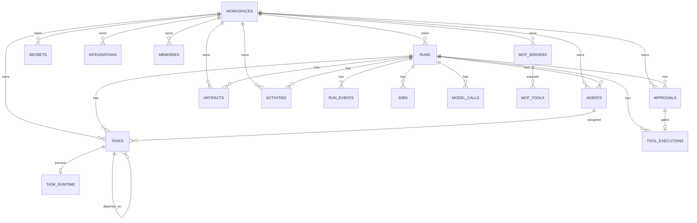

# SWARM — Data Model

**Version:** 0.1  
**Database:** SQLite via Node 24 `node:sqlite`  
**Last updated:** 2026-10-31  
**Related:** [Architecture](ARCHITECTURE.md), [Security](SECURITY_AND_PERMISSIONS.md)

---

## 1. Storage model

SWARM uses one SQLite database, by default at `<SWARM_DATA_DIR>/swarm.db`.

Connection settings:

- `PRAGMA foreign_keys = ON`
- `PRAGMA busy_timeout = 5000`
- `PRAGMA journal_mode = WAL` (file databases)
- `PRAGMA synchronous = NORMAL`

Schema migrations live in `packages/core/src/db/database.ts` and are applied transactionally, one version at a time, recorded in `schema_migrations`.

Current migrations:

| Version | Contents |
| --- | --- |
| 1 | Workspaces, runs, agents, tasks, dependencies, task runtime, approvals, artifacts, activities, run events, secrets, integrations, memories, MCP servers/tools, tool executions, model calls, jobs. |
| 2 | Adds `mcp_servers.env_secret_id`. |

Timestamps are ISO-8601 UTC strings. IDs are prefixed strings such as `run_...`, `task_...`, `apr_...`, `art_...`, generated by `newId(prefix)`. Slugs are normalized per workspace for user-friendly identity.

## 2. Entity relationship overview



## 3. Tables

### 3.1 `workspaces`

A workspace is the tenant-like boundary for runs, memory, integrations, credentials, and MCP servers. v0.1 bootstraps one default workspace, `SWARM HQ`; the API can create more.

| Column | Type | Notes |
| --- | --- | --- |
| `id` | TEXT PK | Prefixed id. |
| `name` | TEXT | Display name. |
| `slug` | TEXT UNIQUE | Stable URL-friendly identifier. |
| `settings_json` | TEXT | JSON: `autoApproveReadOnlyMcp`, `allowExternalHttpWrites`, optional `maxAgents`, `maxTasks`. |
| `created_at`, `updated_at` | TEXT | ISO timestamps. |

Workspace settings constrain runtime behavior. Limits are clamped against server-wide limits. Settings never include credentials.

### 3.2 `runs`

One goal execution.

| Column | Type | Notes |
| --- | --- | --- |
| `id` | TEXT PK | |
| `workspace_id` | TEXT FK | Cascade delete. |
| `goal` | TEXT | Original user goal. |
| `title`, `summary` | TEXT NULL | Derived title/summary. |
| `status` | TEXT | State machine below. |
| `interpretation_json` | TEXT NULL | Validated goal interpretation. |
| `plan_json` | TEXT NULL | Validated workforce plan. |
| `error` | TEXT NULL | Last fatal error, bounded. |
| `cancel_requested` | INTEGER | 0/1, checked by workers and model calls. |
| `model_calls`, `total_tokens`, `cost_usd` | INTEGER/REAL | Denormalized usage for budgets and UI. |
| `created_at`, `started_at`, `completed_at`, `cancelled_at` | TEXT | Lifecycle timestamps. |

Run statuses:

```text
interpreting → planning → executing → reviewing → completed
                    │           │
                    │           ├→ awaiting_approval → executing
                    │           └→ failed
                    └→ cancelled
```

Terminal statuses: `completed`, `failed`, `cancelled`. Cancellation is also durable via `cancel_requested`.

### 3.3 `agents`

A materialized specialist for one run. Agents are snapshots: editing a domain pack does not rewrite historical runs.

| Column | Type | Notes |
| --- | --- | --- |
| `id` | TEXT PK | |
| `run_id`, `workspace_id` | TEXT FK | Cascade. |
| `definition_key` | TEXT | Key from the domain pack (`market_researcher`). |
| `domain_pack` | TEXT | Pack key (`business`). |
| `name`, `role` | TEXT | Display identity. |
| `status` | TEXT | `idle`, `working`, `awaiting_approval`, `done`, `failed`. |
| `model` | TEXT NULL | Resolved model preference. |
| `created_at` | TEXT | |

### 3.4 `tasks`

A unit of work in the run DAG.

| Column | Type | Notes |
| --- | --- | --- |
| `id` | TEXT PK | |
| `run_id`, `workspace_id` | TEXT FK | Cascade. |
| `agent_id` | TEXT FK NULL | Set null if an agent is removed. |
| `task_key` | TEXT | Unique per run. |
| `title`, `description` | TEXT | Prompt input. |
| `status` | TEXT | State machine below. |
| `priority` | INTEGER | 0–100. |
| `depends_on_json` | TEXT | Array of task keys. |
| `deliverable`, `evaluation_criteria_json` | TEXT | Output contract. |
| `input_json`, `output_json` | TEXT NULL | Persisted context/agent output. |
| `artifact_id` | TEXT NULL | Deliverable artifact. |
| `attempts`, `max_attempts` | INTEGER | Retry budget. |
| `error` | TEXT NULL | |
| `created_at`, `updated_at`, `started_at`, `completed_at` | TEXT | |

Task statuses:

```text
pending → ready → running → completed
   │         │        │
   │         │        ├→ awaiting_approval → running
   │         │        ├→ failed
   │         │        └→ cancelled
   │         └→ blocked
   ├→ skipped
   └→ cancelled
```

`listReadyTasks()` selects pending/ready tasks whose dependencies are all completed or skipped, ordered by priority then creation. `dependenciesComplete()` is the execution gate. A run with tasks remaining but no runnable work is failed as a blocked workflow.

`task_dependencies` mirrors the JSON for relational integrity and future querying. Both are kept consistent by `insertTasks()`.

### 3.5 `task_runtime`

The durable agent-loop checkpoint.

| Column | Type | Notes |
| --- | --- | --- |
| `task_id` | TEXT PK/FK | Cascade. |
| `state_json` | TEXT | Versioned `AgentLoopState`. |
| `updated_at` | TEXT | |

State shape:

```json
{
  "version": 1,
  "messages": [
    { "role": "system", "content": "..." },
    { "role": "user", "content": "..." },
    { "role": "assistant", "content": null, "toolCalls": [] },
    { "role": "tool", "toolCallId": "call_1", "name": "web_fetch", "content": "..." }
  ],
  "turn": 2,
  "toolCallCount": 3,
  "corrections": 0,
  "pendingToolCalls": [],
  "pendingApprovalId": null,
  "pendingToolExecutionId": null
}
```

Deleted when a deliverable is successfully stored. Used on approval resume to verify that the approval matches the persisted pending call.

### 3.6 `approvals`

A human decision gate.

| Column | Type | Notes |
| --- | --- | --- |
| `id` | TEXT PK | |
| `run_id`, `workspace_id` | TEXT FK | |
| `task_id`, `agent_id` | TEXT FK NULL | |
| `kind` | TEXT | `tool` or `purchase`. |
| `status` | TEXT | `pending`, `approved`, `denied`, `expired`, `cancelled`. |
| `title`, `summary` | TEXT | Human-facing explanation. |
| `payload_json` | TEXT | Tool execution id, tool name, risk, redacted input. |
| `decision_reason` | TEXT NULL | User reason. |
| `created_at`, `decided_at` | TEXT | |
| `expires_at` | TEXT NULL | 24 hours after creation. |

Approval payload includes `toolExecutionId` and the redacted input. Secrets are not stored in plaintext; sensitive keys are replaced before persistence.

### 3.7 `tool_executions`

Audit record for every attempted tool call.

| Column | Type | Notes |
| --- | --- | --- |
| `id` | TEXT PK | |
| `run_id`, `task_id`, `agent_id` | TEXT FK NULL | |
| `tool_name` | TEXT | Effective registry name (`mcp_...`, `ext_...`, native). |
| `source` | TEXT | `native`, `mcp`, `extension`. |
| `status` | TEXT | `requested`, `awaiting_approval`, `running`, `succeeded`, `failed`, `denied`, `timeout`. |
| `requires_approval` | INTEGER | |
| `approval_id` | TEXT FK NULL | |
| `input_json`, `output_json` | TEXT | Redacted on API projection. |
| `error` | TEXT NULL | |
| `started_at`, `completed_at`, `duration_ms` | | |
| `idempotency_key` | TEXT UNIQUE | Content hash for write-like calls. |

Idempotency is used for non-read calls. A duplicate successful execution is replayed to the model instead of repeating the external action. A duplicate in another state returns an explanatory message and is not re-executed.

### 3.8 `artifacts`

| Column | Type | Notes |
| --- | --- | --- |
| `id` | TEXT PK | |
| `run_id`, `workspace_id` | TEXT FK | |
| `task_id`, `agent_id` | TEXT FK NULL | |
| `kind` | TEXT | `deliverable`, `supporting`, `review`, `final`. |
| `format` | TEXT | `markdown`, `text`, `json`, `csv`, `html`. |
| `title` | TEXT | |
| `filename` | TEXT | Sanitized download name. |
| `mime_type` | TEXT | |
| `size_bytes` | INTEGER | |
| `content` | TEXT | Stored inline. |
| `created_at` | TEXT | |

Content is stored inline for atomic local backup. Limits and object storage are future work. Artifact listing omits content; detail returns it.

### 3.9 `run_events`

Append-only sequence used by SSE/resume.

| Column | Type | Notes |
| --- | --- | --- |
| `seq` | INTEGER PK AUTOINCREMENT | Monotonic cursor. |
| `id` | TEXT | Event id. |
| `run_id` | TEXT FK | |
| `type` | TEXT | `run_created`, `model_call`, `plan_created`, `task_started`, `approval_requested`, `approval_decided`, `tool_completed`, `review_completed`, `run_completed`, `run_failed`, `run_cancelled`, etc. |
| `data_json` | TEXT | Payload. |
| `created_at` | TEXT | |

The API streams events with `seq > after` and sends a projection snapshot when it changes. The event log is not the sole source of truth; tables are.

### 3.10 `activities`

Human-readable audit feed, separate from machine events.

| Column | Type | Notes |
| --- | --- | --- |
| `id`, `run_id`, `workspace_id`, `task_id`, `agent_id` | | `run_id` nullable for workspace-level events. |
| `type` | TEXT | e.g. `task_started`, `tool_denied`, `approval_requested`, `review_fallback`. |
| `level` | TEXT | `info`, `success`, `warning`, `error`. |
| `message` | TEXT | |
| `data_json` | TEXT NULL | Structured context. |
| `created_at` | TEXT | |

### 3.11 `secrets`

| Column | Type | Notes |
| --- | --- | --- |
| `id` | TEXT PK | |
| `workspace_id` | TEXT FK | |
| `name` | TEXT | Human label, not unique. |
| `ciphertext`, `iv`, `tag` | TEXT | AES-256-GCM output, base64. |
| `version` | INTEGER | Crypto format version. |
| `created_at`, `updated_at` | TEXT | |

The encryption key is server-side only. If `SWARM_ENCRYPTION_KEY` is unset, a key is generated at `data/.encryption-key` with best-effort `0600`. Losing the key makes stored secrets unrecoverable.

### 3.12 `integrations`

| Column | Type | Notes |
| --- | --- | --- |
| `id` | TEXT PK | |
| `workspace_id` | TEXT FK | |
| `provider` | TEXT | `github`, `slack`, `google`, `notion`, `linear`, `figma`, `calendar`, `telegraph`, `custom`. |
| `name` | TEXT | User label. |
| `status` | TEXT | `connected`, `disconnected`, `error`. |
| `config_json` | TEXT | Non-secret config. |
| `secret_id` | TEXT FK NULL | Encrypted token/key. |
| `created_at`, `updated_at` | TEXT | |

Unique `(workspace_id, provider, name)`. The API returns `hasSecret`, never the secret itself. `SecretBox.integrationSecret(workspace, provider)` is the runtime access path.

### 3.13 `memories`

| Column | Type | Notes |
| --- | --- | --- |
| `id` | TEXT PK | |
| `workspace_id` | TEXT FK | |
| `memory_key` | TEXT | Unique per workspace. |
| `content` | TEXT | Bounded summary/facts. |
| `tags_json` | TEXT | String array. |
| `created_at`, `updated_at` | TEXT | |

Memory search is keyword overlap, not embeddings. Agents can search and write. Each completed task upserts a bounded `run:<runId>:<taskKey>` summary.

### 3.14 `mcp_servers` and `mcp_tools`

`mcp_servers`:

| Column | Type | Notes |
| --- | --- | --- |
| `id` | TEXT PK | |
| `workspace_id` | TEXT FK | |
| `name` | TEXT | Unique per workspace; part of tool names. |
| `transport` | TEXT | `http` or `stdio`. |
| `url` | TEXT NULL | HTTP endpoint. |
| `command_json` | TEXT NULL | Stdio argv array. |
| `headers_secret_id`, `env_secret_id` | TEXT FK NULL | Encrypted JSON maps. |
| `status` | TEXT | `connected`, `disconnected`, `error`. |
| `last_error` | TEXT NULL | |
| `created_at`, `updated_at` | TEXT | |

`mcp_tools`:

| Column | Type | Notes |
| --- | --- | --- |
| `id` | TEXT PK | |
| `server_id` | TEXT FK | Cascade. |
| `name` | TEXT | Remote tool name. |
| `description` | TEXT | |
| `input_schema_json` | TEXT | JSON Schema. |
| `requires_approval` | INTEGER | Derived from read-only hint. |
| `discovered_at` | TEXT | |

Discovery replaces the tool set for a server. Tool names are namespaced and bounded to 64 characters.

### 3.15 `jobs`

| Column | Type | Notes |
| --- | --- | --- |
| `id` | TEXT PK | |
| `type` | TEXT | `interpret_goal`, `execute_task`, `review_run`, `finalize_run`, `resume_task`. |
| `run_id`, `task_id` | TEXT FK | Task may be null. |
| `status` | TEXT | `queued`, `leased`, `done`, `failed`. |
| `attempts`, `max_attempts` | INTEGER | |
| `available_at`, `lease_until` | TEXT | Scheduling. |
| `idempotency_key` | TEXT UNIQUE | Deduplication. |
| `payload_json` | TEXT NULL | e.g. approval id. |
| `last_error` | TEXT NULL | |
| `created_at`, `updated_at` | TEXT | |

Lease duration is 10 minutes in the engine loop; repository default is 120 seconds when called directly. Expired leases are requeued on worker start. A failed job is retried until `max_attempts` with backoff, then fails the run.

### 3.16 `model_calls`

| Column | Type | Notes |
| --- | --- | --- |
| `id` | TEXT PK | |
| `run_id`, `task_id`, `agent_id` | TEXT FK NULL | Interpretation/planning/review may have no task. |
| `provider`, `model` | TEXT | |
| `prompt_tokens`, `completion_tokens`, `total_tokens` | INTEGER | |
| `cost_usd` | REAL NULL | Null when pricing is unknown. |
| `status` | TEXT | `succeeded`, `failed`. |
| `error` | TEXT NULL | |
| `created_at` | TEXT | |
| `duration_ms` | INTEGER | |

Failed calls are recorded even though they do not increment run usage. This is important for debugging.

## 4. Cross-cutting invariants

1. Every run belongs to exactly one workspace; every task/agent/artifact/approval belongs to the same run/workspace.
2. Task dependencies must reference earlier tasks in the plan and be acyclic.
3. A run cannot be `completed` without a final artifact.
4. Pending approvals are always tied to a task and a tool execution for tool/purchase actions.
5. Approval payload inputs are redacted before persistence and again on API projection.
6. Secrets are never returned from the API. `hasSecret` is the only exposure.
7. A tool execution with a write-like idempotency key cannot be duplicated.
8. Jobs are scheduled at most once per idempotency key.
9. Cancellation sets the durable flag and blocks new budget-consuming calls.
10. A review or final synthesis fallback is explicitly stored as a fallback artifact/activity, never passed off as a model success.

## 5. Retention and deletion

- Foreign keys use `ON DELETE CASCADE` for run/workspace-owned data.
- Deleting a workspace removes its runs, agents, tasks, approvals, artifacts, activities, events, secrets, integrations, memories, MCP servers/tools, jobs, tool executions, and model calls.
- Secrets referenced by integrations are set null on secret deletion; MCP references likewise.
- There is no automatic retention policy in v0.1. Operators must back up and prune the SQLite file deliberately.
- Artifact content is immutable after creation. There is no edit/version surface.

## 6. Backup and recovery

For a consistent local backup:

1. Stop the API/worker (or use SQLite's online backup API).
2. Copy `data/swarm.db` and `data/.encryption-key` together.
3. Copy `data/extensions/` if used.
4. Store the encryption key separately from the database when possible.

Without the key, encrypted integration/MCP secrets are unusable. The database still opens; secret-dependent tools fail closed.

## 7. Scale characteristics

- Writers are serialized by SQLite. WAL allows concurrent readers.
- Each task and model call writes rows; a typical run is small (tens to low hundreds of writes).
- Artifact content is inline and may make the database grow quickly if large deliverables are common.
- Job polling is every 750ms in the inline worker.
- No pagination beyond list limits (runs 200, artifacts 500, activities 500, tasks 500, workforce 500, memory 200).
- No retention or archival.

## 8. Postgres migration path

The `Store` class is the persistence seam. A hosted implementation should:

1. Preserve the contract types and repository methods.
2. Map `*_json` columns to `jsonb`.
3. Replace SQLite transactions with Postgres transactions/serializable isolation where needed.
4. Replace the leased `jobs` table with a queue or `SELECT ... FOR UPDATE SKIP LOCKED` worker pool.
5. Move artifact content to object storage and keep metadata in Postgres.
6. Add workspace/tenant row-level security and per-tenant encryption keys.
7. Add migrations with the same version discipline.
8. Keep run events append-only and expose them through the same SSE projection.

The API and engine should not need to know which storage backend is active; they depend on the repository interface and contracts.
